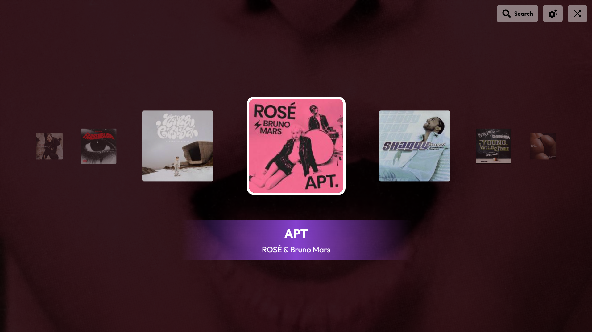
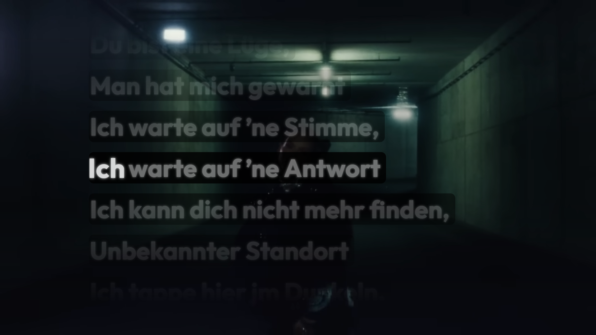

# vibes

|      Song Carousel      |      Lyrics Player      |
| :---------------------: | :---------------------: |
|  |  |

_vibes_ is a small karaoke application that plays local media with synchronized UltraStar lyrics or YouTube captions. It interfaces with USDB Animux and uses yt-dlp to download media for offline playback.

**Disclaimer**: Vibes is a client-side tool only. It does not host, distribute, or own any media files or song lyrics. All content is fetched dynamically from third-party sources. Users are responsible for complying with the Terms of Service of any accessed platforms and ensuring they have the legal right to use the respective audio and video files.

## Installation

Vibes provides first hand support for Windows. MacOS and Linux are also supported but may be less stable. You can download the latest release from the [releases page](https://github.com/harrydehix/vibes/releases).

### Troubleshooting

The app manages its own yt-dlp executable in its user-data directory and checks for yt-dlp updates on startup. Failed update checks fall back to the installed version. If downloads fail, check the full yt-dlp error in the app logs; YouTube restrictions and caption availability can vary by video and region.

FFmpeg and FFprobe are also app-managed. On every startup, vibes checks both executables with `-version`; missing or damaged files are installed from the bundled platform binaries into the `ffmpeg` subfolder of the app's user-data directory. Downloads explicitly use that directory, so no system FFmpeg installation is required. The tools merge separate video/audio streams and remux the result to MP4 when needed.

Problems with starting the application on mac are propably caused by my missing developer id. You have to self sign the app by using `sudo codesign --force --deep --sign "LocalCertificate" /Applications/vibes.app
`.

### Auto updates

Once installed vibes will automatically check for updates on startup and install the latest version on restart. Your currently installed version will be displayed in the start screen's bottom left corner.

## Usage Tips

### Keyboard Shortcuts for the Lyrics Player

Use `C` to toggle an additional background to make the lyrics more readable.

Use `ArrowUp` and `ArrowDown` to change the sync time of the lyrics dynamically if they are not perfectly in sync with the music while playing a song.

Use `Esc` to open the pause menu. From there you can restart the song, go back to the song list, change settings or quit the app.

### Keyboard Shortcuts for the Song Carousel

Use `ArrowLeft` and `ArrowRight` to navigate the song list. Press `Enter` to play the selected song.

Use `Esc` to quit the app.

### Controller Support

Controllers aren't fully supported yet. Some basic actions like play/pause and navigating the song list work, but more complex interactions aren't fully implemented yet.
